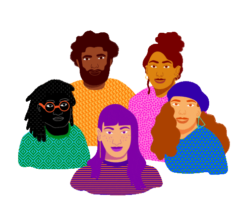

<h1 align="center">Gaurav KR Vishwakarma</h1>
 <b>IBM & UTM Certified Data Scientist</b> | Data Analyst at Acuity Knowledge Partners, Gurgaon  <i>Looking for a new challenge in Data Science & Analytics | Highly skilled in Python</i> 

  
<h2 align="center">Connect With Me</h2>
      

  
<h2>About Me</h2>
🔭 I'm currently working on NLP
🌱 I'm currently working as a Data Analyst
💬 Ask me about NLP, ML, AI, Flask, Python, R Programming, PowerBI, Tableau, Streamlit, Heroku
📫 How to reach me: @Gaurav KR Vishwakarma

  
<h2 align="center">GitHub Stats</h2>
  

  

  
<h2>Dashboards</h2>
Super Store Dashboard — Superstore Sales Analysis Dashboard on Tableau
<h2>Technologies I Have Used</h2>
        

       

        
<h2>See My Projects</h2>
👉 Gaurav KR Vish / projects — My Portfolio Website
👉 GitHub Repositories
<h2>Support</h2>

  

⭐ Thanks for visiting my profile! ⭐

